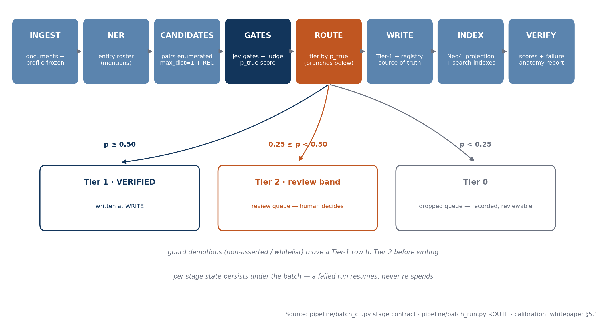
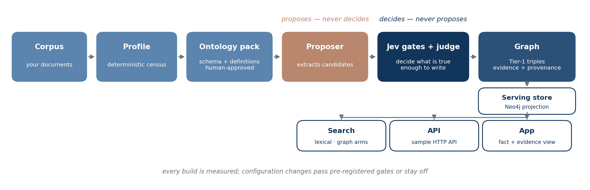
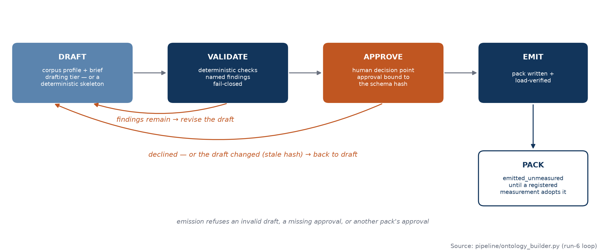
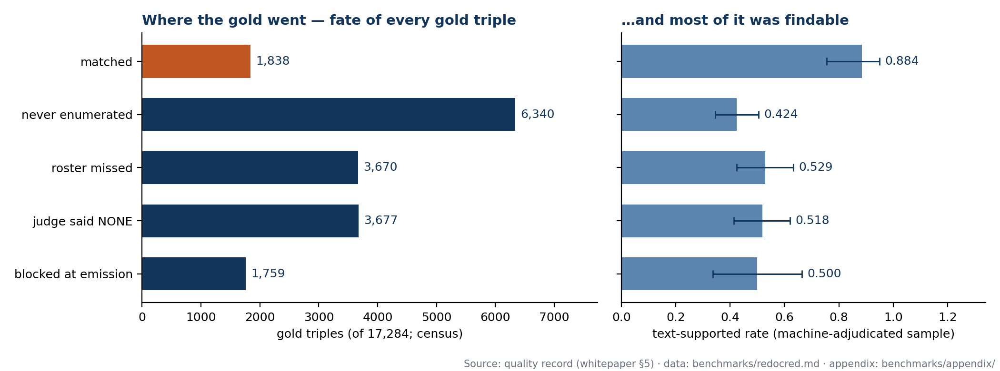

# OntoSmith: A Decision-Model-Based Ontology & Knowledge-Graph Builder

**A technical white paper**

| | |
|---|---|
| **Author** | Dongbum Lee |
| **Status** | Pre-release draft for v1 — 2026 |
| **Product** | OntoSmith — *Powered by Jev, the decision (judge) model inside OntoSmith* |
| **License of the product** | MIT (Copyright © 2026 Dongbum Lee) |

> **A note on evidence.** This paper is the canonical home of
> OntoSmith's quality record. The scores reported in §5 are
> published here — and not on the product's front surface —
> because a naked score invites context-stripped misreading.
> Here, every number travels with its scope, its method, and
> its failure anatomy. Every corrected number rests on
> **machine adjudication** under a pre-registered protocol;
> the labels are machine judgments, not a human audit, and
> they are not a corrected gold dataset.

---

## Abstract

Most knowledge-graph tooling starts from whatever a language
model happens to extract. OntoSmith starts from the ontology.
A human designs the schema first — entity and relation types,
definitions, boundary examples — approves it explicitly, and a
pipeline then builds the graph *under* that schema, separating
proposing from judging at every step: a low-cost proposer
extracts candidates, a fitted pair call (fitted: a
configuration adopted through a pre-registered
measurement gate) converts enumerated pairs into
candidate triples, and deterministic gates and the Jev
decision model decide what is true enough to write, and
every written
triple carries its evidence span and provenance.

Operating
points are adopted only through pre-registered measurement
gates; configurations that miss their gate stay off, and the
rejections are part of the published record.

This paper describes the system (§3–§4), then reports the
measured quality of its flagship build (§5): over all 500
documents of the Re-DocRED dev split, the build's raw
benchmark precision of 0.5723 corrects — under blind,
stratified, machine-adjudicated sampling under a ruled
adjudication contract — to **0.9110 [0.8919–0.9275]**,
with ceiling-adjusted recall **0.2028**.
Those scores describe the measured build: the 3,902-triple
Tier-1 set of the sentence-window configuration (§5.1).
The shipped default configuration differs in enumeration
(§5.6), and the shipped Tier-1 set includes 186 promoted
triples whose corrected precision is not recomputed.

The record keeps its failures in place: one pre-registered
criterion failed, the rejected judge configurations are
listed, and the failure anatomy separates the two
ceilings on recall — enumeration coverage, and how much
of the gold itself survives as typed. We close
with an explicitly-marked design direction — ontology
evolution, lightweight schema governance, and document
lifecycle management (§6) — and with what v1 is not (§7).

---

## 1. Problem

Knowledge graphs built by language models inherit the
models' failure modes. An extractor asked to "find the
relations" will find plausible ones: it over-fires on
co-occurrence, fabricates supporting spans, types relations
by surface feel, and merges entities that merely share a
name. The output looks like a graph; its precision is
unknown, and usually unmeasured. Three structural problems
follow:

1. **No schema discipline.** Without a designed ontology —
   types with definitions and boundary examples — there is
   nothing to judge a candidate *against*. "Is this triple
   right?" quietly becomes "does this triple sound right?"
2. **Proposer and judge are the same seat.** When the model
   that extracts also decides, its confidence is the only
   gate, and confidence is not calibrated to truth.
3. **Quality is asserted, not measured.** Benchmark gold is
   itself incomplete — Re-DocRED exists precisely because
   DocRED's gold misses most true relations — so a raw
   benchmark score punishes a builder for the gold's gaps
   and rewards nothing in particular. A builder that reports
   only raw scores is reporting the benchmark's noise as its
   own quality, in whichever direction flatters it.

OntoSmith's answer is architectural, not prompt-level:
design the ontology as data, separate proposing from
judging, pin the judge, and measure the result with a
protocol that prices the gold's own incompleteness — then
publish the measurement, failures included.

## 2. Approach

**Design the ontology.** Every build runs under a *pack*:
a domain's ontology as data — schema, definitions, boundary
examples, thresholds, and the pack's measured conformance
record — versioned, hash-pinned, and fail-closed on load.
Domain content lives only in packs, never in code branches.
A pack is drafted from a corpus profile by the ontology
builder, validated deterministically, and emitted only
after explicit human approval; an emitted pack is marked
`emitted_unmeasured` until a registered measurement adopts
it.

**Build under it.** The pipeline censuses the corpus first
(deterministically, at zero model cost), enumerates
candidate entity pairs from a roster, lets a proposer
propose, and submits every candidate to judgment:
deterministic gates plus **Jev**, a pinned decision-model
component, and a fitted pair judge. Candidates in the
uncertain band go to a human review band rather than being
forced through. Written triples are tiered; Tier-1 is the
set the gates certify.

**Serve it.** The build's registry is the source of truth;
the serving graph is a rebuildable projection of it into
Neo4j, supporting traversal and hybrid retrieval (vector +
lexical + graph) over chunks and triples. §4 details the
serving shape; §7 states plainly how much of it v1 ships.

**Measure everything, adopt by gate.** Thresholds, the
enumeration window, and the judge configuration are not
taste: each was chosen by a pre-registered cell with a
registered bar, and the ones that missed are recorded as
rejected (§5.5). This discipline — decide the bar before
the run, publish the outcome either way — is the paper's
method as much as the product's.

---

## 3. System

### 3.1 The pipeline

A build is a batch: an immutable manifest at ingest (the
bill of materials — source list, document count, a
tamper-evident hash over the sorted document ids, and pins
for the profile and pack the build runs under), then eight
stages:

**INGEST → NER/roster → CANDIDATES → GATES → ROUTE →
WRITE → INDEX → VERIFY.**

These eight stages are the build step of the product's
user-facing loop (profile → design → build → inspect →
verify → serve); the design step is the profiler plus
the ontology builder (§3.3–§3.4), and VERIFY runs the
same verification cores the loop's verify step exposes.

- **INGEST** freezes the corpus snapshot and writes the
  manifest. A batch that dies mid-run resumes from its
  ledger and manifest instead of re-spending.
- **NER / roster** builds the document's entity roster —
  the population every later stage is accountable to. (The
  flagship record shows why this stage matters: 3,670 of
  17,284 gold triples were lost because an endpoint never
  made the roster.)
- **CANDIDATES** enumerates entity pairs inside the
  configured window and the proposer proposes triples for
  them, each with an evidence span.
- **GATES** applies the deterministic gates and the Jev
  decision model: a pinned, versioned judgment component
  (`typesafe/jev-1.13`) scoring candidate triples against
  the pack's definitions — precision seat, not a generator.
- **ROUTE** tiers the survivors: Tier-1 (the verified
  tier), the human review band (scores in the registered
  band, 0.25–0.50 under the flagship calibration), and
  rejected.
  Entity resolution runs under its own threshold, with a
  cross-document merge floor (p_same ≥ 0.85) guarding
  against name-only merges.
- **WRITE** persists triples with evidence spans and full
  provenance (document, pair, verdicts, binding, schema
  version) into the registry.
- **INDEX** projects the registry into the serving store.
- **VERIFY** runs the shipped verification cores — raw and
  corrected scoring, failure anatomy, cost projection —
  the same tooling this paper's §5 record was produced
  with.

> **Figure 1 — The batch pipeline.**
> Eight stages with the ROUTE tier branches, as coded in
> the product's `pipeline/` — rendered from the shipped
> stage contract by `harness/render_charts.py`.
>
> 

> **Figure 2 — The method.**
> Proposer/judge separation across the build loop: the
> fitted pair call converts enumerated pairs into
> candidates; the deterministic gates and Jev decide
> what is written — nothing reaches the graph on the
> proposing seat's say-so alone.
>
> 

### 3.2 The judgment architecture

The separation of seats is the system's core invariant:

- **Proposer** (a low-cost model tier): extracts candidate
  triples and evidence spans. It has no write authority.
- **Deterministic gates**: span verification (a claimed
  evidence quote must occur verbatim in the document),
  schema conformance, duplicate and consistency checks.
  These are code, not prompts.
- **Jev, the decision model**: a pinned product component
  that judges candidates against the pack's ontology
  definitions. Jev is treated the way a compiler version is
  treated — pinned, named in every run record, changed
  only as a product decision.
- **Fitted pair judge**: the conversion call of the
  pair-enumeration path — one call per enumerated pair
  that judges whether the pair supports a triple and,
  when it does, emits the triple with its direction. Its
  configuration (JF-F1: sentence context + a direction
  slot) was itself adopted through a pre-registered gate
  (§5.5), because judge configuration measurably moves
  conversion and direction errors. It runs on the
  proposer seat (below).
- **Human review band**: the band between the accept and
  reject thresholds is not a failure of automation; it is
  the designed seat for human judgment, with the band's
  width a measured parameter.

The conversion step, stated plainly: in the
pair-enumeration configuration — the flagship's, and
the shipped default's — judgment and emission happen
in a single call. The pair judge runs on the
**proposer seat**: in the reference profile it is the
proposer's own model (`anthropic/claude-haiku-5.5`) in
a second, separately fitted configuration, and one
call per enumerated pair both judges whether the pair
supports a triple and emits the triple it supports.

So the separation this architecture actually enforces
is not "the proposer never judges" — the pair call
judges. It is this: **nothing is written on the
proposing seat's say-so alone.** Every converted
triple still passes the deterministic guards, faces
**Jev's** verdict at GATES, and is tiered by ROUTE's
thresholds before anything reaches the graph — and
the pair configuration that does the converting is a
fitted, measured configuration, not the proposer's
free extraction.

Frontier-model escalation exists in the harness as a
bounded instrument (band-only, judging roles excluded, a
registered promotion rule) and is **off by default** in
the product configuration.

### 3.3 Packs: the ontology as governed data

"Ontology", as the word is used in this paper and in the
product, names a versioned data artifact: an inventory of
entity and relation types, each with a definition and
boundary examples, against which candidate claims are
judged. It is not an axiomatised ontology in the
description-logic sense — v1 ships no class subsumption,
no disjointness axioms, and no entailment regime — and
the word should not be read as claiming those properties.
What the artifact governs is admission: which types a
claim may use, and what each type means, stated once and
judged against consistently.

A pack carries: the schema (entity/relation inventories),
definitions living in exactly one place, boundary examples,
fitted qualifiers and normalization tables, thresholds, and
a **conformance record** — the pack's memory of what was
measured on it, positive and negative results alike, so a
failed fitting is not proposed twice. Content changes bump
the pack version; the loader verifies the hash pin and
refuses a silently altered pack.

Three packs ship with v1, named for their domains, with
their validation corpora stated as provenance: **Bio
Medical** (validated on BioRED), **Legal Contract**
(validated on CUAD), and **Open Domain** (validated
on Re-DocRED), over a domain-neutral **Core** baseline.
§5.7 summarizes their records.

### 3.4 The ontology builder

New domains do not start from a blank file. The builder
runs a loop — **draft → validate → approve → emit** — from
the corpus profile: draft a schema (definitions and
boundary material included), validate it deterministically
(unnamed types, definition forks, and inventory mismatches
are findings, not warnings), present an approval brief, and
emit the pack only on a recorded human approval bound to
the draft's hash. A stale or mismatched approval refuses
emission.

> **Figure 3 — The ontology builder loop.**
> Draft, validate, approve, emit — with refusal paths.
> An emitted pack is `emitted_unmeasured` until a
> registered measurement adopts it. Rendered from
> `pipeline/ontology_builder.py`.
>
> 

## 4. Bindings, cost, and serving

### 4.1 Reference profile vs. custom bindings

Measurements are statements about a configuration, so the
configuration is named. The bindings used for this paper's
record ship as the **reference profile** — the default
connection-layer preset:

| Seat | Reference binding |
|---|---|
| Proposer / pair judge tier | `anthropic/claude-haiku-5.5` (JF-F1 configuration) |
| Decision gate (Jev, pinned) | `typesafe/jev-1.13` |
| Escalation | `anthropic/claude-sonnet-5.5` |
| Drafting | — (ships unbound; bind your own) |
| Embedder | `openai/text-embedding-3-large` (3072 dims) |

The published numbers reproduce keyless from the shipped
appendix (the replay, README step 2); a default install
runs the same bindings this record was measured under.
Packs declare only *capability tiers* (proposer / judge /
escalation) — never model names — so a user may bind other
models in the connection layer. That is a **custom
binding**: supported by design, and its numbers are the
user's to re-measure. Run records state which binding
produced them; API keys are environment values, never
settings.

The measured configurations behind this record
rest on comparative measurement where comparisons were
run — the extraction bake-off and the judge-configuration
gates, whose records are §5.5 and §5.8. The
decision-model seat itself is a pinned product
component, not a seat chosen by a published head-to-head
bake-off; no Jev-versus-frontier judgment comparison is
in this record, and none should be inferred from it.

*Note, 2026-10-23 — the binding layer generalized; the
record did not move.* The declaration path is now a
front door (`ontosmith configure`, interactive or from
a template file) that writes the per-seat binding as
its artifact, with zero-spend probes and a binding
stamp. Each seat additionally declares a provider
**dialect**: the preset's dialect may emit
provider-only request fields; a custom binding
defaults to the portable OpenAI-compatible subset, so
those fields are never sent to a route that did not
declare them. Cost accounting is stamped with its
basis — provider-reported, estimated from
user-declared rates, or not-provided — and an unknown
cost is recorded as unknown (no rate is ever invented
in code); a USD stop-line set over a seat that cannot
meter cost refuses by name instead of silently never
tripping. Model-name pattern matching for request
shape is replaced by declared capabilities, with
model-id derivation retained only as the undeclared
default.

What
deliberately did **not** change: the reference
profile's values above — the preset request bytes are
unchanged, guarded by byte-identical request fixtures —
and the judge seat's contract, whose unit of
generalization is the decisions route rather than
another chat model. §5.6's provider row is the
historical record of the measured run and stands as
written.

### 4.2 Cost guardrails

Spend is guarded by default. Before a run, the tooling
prints a **counted projection** — candidate pairs counted
from the user's own rosters, priced at caller-supplied
rates (`--unit-cost`); the tool takes prices from the
caller and never reads a rate from the bound models.
Every batch enforces a **stop-line**: a run that
would cross its cap refuses the unit that crosses it and
resumes from its ledger instead of re-spending. §5.6 gives
the flagship run's projection, ledger, and the governing
provider-observed total — published at aggregate level,
with the method; the full ledger itself is internal
provenance and is not published.

### 4.3 Serving

The **registry is the source of truth**; the graph in
**Neo4j** is a rebuildable projection of it (traversal,
native vector index, Lucene full-text). Retrieval is
hybrid — vector + lexical + graph — over chunks and
triples. This separation is deliberate: the store can be
rebuilt, replaced, or re-projected without touching the
evidence-bearing record, and every served triple can be
inspected back to its evidence span and provenance chain.

The same-QA comparison the product cares about — graph +
hybrid vs. plain hybrid retrieval — is measured, with its
scope, in §5.7–§5.8: the graph's advantage is real on long
documents and measured at exactly zero on short abstracts.

---

## 5. The quality record

This chapter is the canonical quality record for
OntoSmith's flagship build — including the criterion
that failed. The supporting records for the
Bio Medical and Legal Contract packs are carried in full
in §5.7–§5.8, at the same standard: failures included,
nothing silently revised. §5.9 records the Open Domain
pack's earlier pilot audit.

> **Label.** Every corrected number in this record rests on
> **machine adjudication**: blind samples judged by machine
> judges under the adjudication contract
> ([ADJUDICATION.md](ADJUDICATION.md) — the as-typed
> contract completed by its six seam rulings), with
> verbatim-quote verification and embedded controls. They
> are machine judgments, not a human audit, and they are
> not a corrected gold dataset. The samples and verdicts
> ship as a supplementary appendix to the product's quality
> record so a reader can re-check them, and a replay script
> recomputes every headline of this record from the
> appendix files alone.

### 5.1 The build

- **Corpus:** Re-DocRED dev split, all 500 documents
  (17,284 gold triples).
- **Configuration:** the fitted configuration chosen by
  the pre-registered gate cells (§5.5): roster-first
  enumeration (RS-01) in the sentence window, the JF-F1
  pair judge (sentence context + direction slot),
  deterministic gates, Tier-1 routing.
- **Reference profile:** as §4.1, with gate calibration —
  triple threshold 0.25 · review band 0.25–0.50 · ER
  threshold 0.40 · cross-document merge floor p_same 0.85.
- **Output:** 26,938 candidate pairs judged (all verdicts
  direction-bearing); Tier-1 = **3,902 triples**. A later
  supplementary promotion under the same gate added 186
  triples from guard-restored candidates, fixing the
  shipped readout at Tier-1 **4,088**; the corrected scores
  below are the record's estimates over the measured
  3,902-triple population and are not recomputed over the
  promoted set.
- **Run date:** 2026-10-21.

### 5.2 Headline scores

Raw scores are a census over the full gold population with
the frozen scorer. Corrected scores are stratified sample
estimates (§5.4) that price how incomplete the gold itself
is.

| Score | CONF-440 (440 docs) | FULL-500 (500 docs) |
|---|---|---|
| Raw precision / recall / F1 (census) | 0.5735 / 0.1059 / 0.1788 | 0.5723 / 0.1063 / 0.1793 |
| TN-normalized P / R / F1 (census) | 0.5749 / 0.1227 / 0.2022 | 0.5736 / 0.1229 / 0.2024 |
| **Corrected precision** (sample est., machine-adjudicated) | **0.9121** [0.8897–0.9310] | **0.9110** [0.8919–0.9275] |
| **Ceiling-adjusted recall** (sample est., machine-adjudicated) | **0.2036** [0.1852–0.2262] | **0.2028** [0.1856–0.2237] |

Reading: the estimator counts a Tier-1 triple as
supported when it is either an exact gold match (priced
at 1.0 by construction) or, for the 1,669 triples with no
exact gold match, judged supported under the ruled
adjudication contract (§5.4) — so of every 100 Tier-1
triples the fitted configuration emits, ≈ 91 count as
supported in one of those two senses.

The estimator
prices exact gold matches at face value; if the matched
stratum is instead priced at the support rate the same
contract measured among the re-checked matched triples
(§5.3's matched stratum, ≈ 0.884), the same estimate
reads ≈ 0.845. The raw 0.57 benchmark precision is
mostly gold's false-negative mass — the failure mode
Re-DocRED was built to repair — repriced by how much of
that mass survives an explicit as-typed reading. Recall
is the honest weak side, and the next section shows
exactly where it went.

### 5.3 Failure anatomy (FULL-500, gold census)

Every one of the 17,284 gold triples has exactly one fate:

| Gold fate | Count | What it means |
|---|---|---|
| matched | 1,838 | Emitted in Tier-1 exactly |
| emission_blocked | 1,759 | A covering pair was judged OK, but no Tier-1 exact match was emitted |
| none_judged | 3,677 | The pair was enumerated; the judge answered NONE |
| never_enumerated | 6,340 | Both endpoints rostered, but never co-occurring inside the sentence window |
| roster_missed | 3,670 | An endpoint never made the roster |

10,010 of 17,284 gold triples (57.9%) were never enumerated
at all. The adjudication sample prices how much of each
fate was even findable — text-support rates by fate
(machine-adjudicated, decisive items):

| Gold fate | Sampled | Text-supported rate |
|---|---|---|
| matched | 44 | 0.884 [0.755–0.949] |
| none_judged | 86 | 0.518 [0.413–0.621] |
| emission_blocked | 32 | 0.500 [0.336–0.664] |
| never_enumerated | 153 | 0.424 [0.346–0.505] |
| roster_missed | 85 | 0.529 [0.424–0.632] |

Under the ruled contract, only about half of the gold in
every loss stratum is supported as typed. Two ceilings
therefore bind this pipeline's recall, and the anatomy
keeps them separate: enumeration coverage — 57.9% of gold
never enumerated at all — caps what the pipeline can
reach, and gold's own as-typed support (ĝ_B = 0.5244,
§5.4) caps what even perfect enumeration could be
credited with.

> **Figure 4 — Failure anatomy of the flagship build.**
> Gold fates and per-stratum text-support rates, rendered
> from this record (the plotted numbers are parsed from
> the record itself, never retyped) by
> `harness/render_charts.py`.
>
> 

### 5.4 Method in brief

- **Adjudication contract.** Every corrected figure in
  this record is judged under the adjudication contract
  ([ADJUDICATION.md](ADJUDICATION.md)): blind, as-typed
  judging with verbatim-quote verification and embedded
  controls, completed by six explicit **seam rulings** —
  adjectival (demonym) values and prominently presented
  notable works accepted; neighbouring relations,
  subject-identity shifts, dropped qualifiers, and
  non-transitive containment rejected as typed. The
  rulings are part of the measurement. Cross-family
  agreement under the ruled contract itself has since
  been re-measured on a fresh sample (addendum at the
  end of this section, 2026-10-23): a judge from the
  original panel's family agreed with the ruled
  verdicts on 77.3% of the comparable pairs (Cohen's
  κ = 0.4271, three-category) — the contract narrows
  cross-family divergence but does not eliminate it,
  and the residual disagreement runs lenient against
  the ruled set's stricter readings. The claim made
  here is the narrower one — the six seam classes that
  produced the original divergence are now decided by
  the contract's text, not left to each judge's
  reading.
- **Direction A (precision).** Population: the 1,669
  Tier-1 triples with no exact gold match. A stratified
  sample of 300 (strata: pair-matched 60 / no-gold-pair
  240; seed 20261022), plus 40 exact-matched triples
  shuffled in blind as controls. Judges saw no gold status,
  stratum, or control flag. Support estimate p̂_A = 0.7919
  [0.747–0.831]; the 40 controls were judged **37/40
  supported** under the ruled contract — the three
  exceptions are seam cases the rulings decide against
  the typed claim (two identity shifts, one neighbouring
  relation), reported rather than smoothed; controls sit
  beside the estimate, never inside it.
- **Direction B (gold support).** Population: all 17,284
  gold triples; stratified sample of 400 by document
  population (seed 20261023). ĝ_B = 0.5244 [0.475–0.573] —
  the supported-as-typed fraction of gold. Under the
  ruled contract only about half of gold survives as
  typed: a large share of what a raw benchmark counts as
  extraction error is gold-side surface and
  relation-precision noise, and the ceiling adjustment
  prices exactly that.
- **Quote verification.** A supported verdict counts only
  with a verbatim quote from the document. Under the
  ruled verdict set, 11 of the 740 verdicts failed
  verification and were recorded unknown, excluded from
  every denominator. Unclear items (3 + 3) are likewise
  excluded; counting them as not-supported moves no
  conclusion.
- **Estimation code.** The estimators ship with the product
  as verification cores (corrected precision,
  ceiling-adjusted recall, stratified estimation with
  intervals). Every interval attached to §5's corrected
  estimates is a Wilson-style 95% interval; for the
  stratified estimates it is computed from the
  estimator's variance via an effective sample size, as
  implemented in the shipped scoring core. The shipped cores were verified against the
  original instruments before this record was written:
  26/26 module-level comparisons equal, and the earlier
  audit headlines reproduce exactly through them.
- **Samples and verdicts.** The judgment samples, their key
  files, and the verdicts ship as the supplementary
  appendix to the quality record, labeled machine
  judgments — evidence a reader can re-check, not a
  standalone dataset. Both verdict sets ship: the original
  protocol's, and the ruled re-adjudication's with the
  ruling text the judges received; the replay recomputes
  both estimates, and this record's headlines are the
  ruled ones.

**Provenance — how this record got its contract.** The
figures above are the second pricing of the same frozen
build. The first, under the original adjudication protocol
(the as-typed contract before its seam rulings), read
corrected precision 0.9765 [0.9641–0.9847]. After the
record was frozen, its 740 verdicts were stress-tested
under a pre-registered design: a blind re-adjudication of
a stratified 200-item sample by a judge from a different
model family (GPT-5.5; the original panel was of the
Anthropic line) agreed with the shipped verdicts on
81.5% of items, against a pre-registered 95% bar, and
scored 29/40 on freshly planted blind controls. (On the
same counts, Cohen's κ ≈ 0.45 — at this verdict base
rate the raw agreement figure overstates concordance,
and both numbers are reported.)

The
disagreements were one-directional (35 of 37 flips ran
supported → not-supported) and concentrated in six
recurring surface situations the contract had never
defined. Those situations were settled by the rulings
above; all 565 flagged items were then re-judged blind
under the ruled contract by the stricter judge family —
186 verdicts changed (177 of them supported →
not-supported; the demonym ruling changed none of the 22
items it decided) — and the record was re-priced through
the identical estimator, which first reproduces the
original figures from the original verdicts.

The
original panel's readings were sound where the contract
was explicit and loose exactly where it was silent; the
contract now ships with its rulings stated, not implied.

**Addendum (2026-10-23) — cross-family agreement of the
ruled contract, re-measured.** The follow-up recorded in
this section's first bullet has landed. A fresh
stratified sample of 150 items was drawn from the
shipped direction-A adjudication sample (non-control
items; strata no-gold-pair 120 / pair-matched 30; seed
20261024) and judged blind under the ruled contract —
the base contract and seam-rulings text of
[ADJUDICATION.md](ADJUDICATION.md), extracted from that
document at run time — by `anthropic/claude-sonnet-5.5`,
a judge from the original panel's family (the Anthropic
line). The reference verdicts are the shipped **ruled**
set (GPT-5.5 family). Of the 150 sampled items, 110
carry a ruled verdict — the ruled set covers the
seam-flagged items — and agreement is computed over
those 110 pairs. The fresh judge's verdicts over all
150 items: supported 127, not-supported 19, and 4
recorded *unlabeled* (supported readings whose evidence
quote failed the contract's verbatim verification).

Both κ conventions are reported, labelled: (a)
three-category, over all 110 comparable pairs —
agreement 0.7727, Cohen's κ = 0.4271; (b) decisive-only,
over the 106 pairs where both sides returned a decisive
verdict — agreement 0.8019, κ = 0.4723. The disagreement
is asymmetric, stated plainly: on decisive pairs the
fresh judge read supported where the ruled set read
not-supported 18 times, and the reverse 3 times — the
residual cross-family divergence under the ruled
contract runs lenient, against the ruled set's stricter
readings. This measurement prices agreement between two
judge families under one contract; it re-prices
nothing, and no figure in §5.2–§5.3 changes.

Limitation: the shipped appendix does not carry the
first recheck's item list, so overlap between this
fresh-seeded sample and the original 200-item recheck
sample cannot be excluded from shipped data alone; the
seed is published above so the sample itself is
reproducible. The run's sample, verdicts, results, and
runner ship in the appendix
(`benchmarks/appendix/judgments_e6/`). Spend: $1.0443
for the completed run; ≈ $1.18 in total, of which $0.14
went to three crashed partial attempts (two transport
failures and one response-parse failure) — under the runner's
$6 cap and a $5 key limit.

### 5.5 Pre-registered criteria and gate records

The build was scored against criteria registered before
the run. Five pass; one fails, and it is recorded as a
failure. (Measured values are the record's current
figures under the ruled adjudication contract, §5.4; the
verdicts are as the gates fired — no verdict turns on the
re-pricing.)

| Criterion | Bar | Measured | Verdict |
|---|---|---|---|
| C-1 conversion η, CONF-440 | ≥ 0.21 | 0.2519 | PASS |
| C-2 NONE-loss share of reachable gold, CONF-440 | ≤ 0.50 | 0.5128 | **FAIL** |
| C-3 flip rows, CONF-440 | ≤ 3% of kept | 1.13% | PASS |
| C-4 corrected precision | ≥ 0.55, CI lower ≥ 0.48 | 0.9110 [0.8919–0.9275] | PASS |
| C-5 parse-family / bad-direction outcomes | ≤ 1% each | 0 / 0 of 26,938 | PASS |
| C-6 spend within caps; $/doc within +25% of projection | — | §5.6 | PASS |

C-2 is the honest failure: of the gold pairs the enumerator
did reach, the judge still answers NONE on 51.3% (FULL-500:
0.5059). NONE-loss is the largest judge-side loss, and the
fitted configuration did not move it.

Configuration changes are adopted only through
pre-registered gates. The rejections are part of the
record:

- **JF-F1 (direction slot) — adopted.** Conversion η
  0.1124 → 0.2596; direction flips 131 → 7; candidate
  precision 0.3464 → 0.8381.
- **J5s0 (subset guidance) — measured, not adopted.**
- **J3F / J3F2 (document-context judges, targeting
  NONE-loss) — measured, not adopted.** J3F2 missed its
  conversion gate by ≈ 2 gold pairs (0.3071 vs the
  registered 0.3096) and was rejected without
  reinterpretation.
- **Enumeration cell — adopted as the shipped default.**
  See §5.6.

### 5.6 Operating point and cost of the reference run

The shipped enumeration default is **max_dist=1 + REC**
(sentence distance 1 with deterministic name recovery),
chosen by its registered cell, not by preference:

| | Sentence window (this build) | max_dist=1 + REC (shipped default) |
|---|---|---|
| Candidate pairs (dev-500) | 26,938 | 52,463 |
| Judging cost | $18.0029 realized (candidate judging; the full run ledger is $18.6802) | $35.06 projected at the realized per-pair rate |
| Ceiling-adjusted recall | 0.2028 measured | 0.1884 estimated |

The fit-slice conversion cell behind the adoption measured
η_new 0.1403 against its registered gate, with the new
Tier-1 additions' corrected precision at 1.0000 on the
cell's adjudicated sample. The shipped default's recall
figure is the projection made at adoption, under the
adjudication of its day; the ruled re-price (§5.4) has
since raised the measured sentence-window figure past
it, and the projection stands as recorded rather than
recomputed. The narrower sentence window
remains available as the cheaper option.

**Cost (aggregate).** The full per-stage ledger and
any program totals are internal provenance and are not
published; what follows is the reference run at aggregate
level, with the assumptions needed to recompute it.

| Item | Value |
|---|---|
| Reference run | The flagship build above (500 docs, 26,938 pairs) |
| Run date | 2026-10-21 |
| Provider / route | OpenRouter, reference profile (§4.1) |
| Stage spend — roster pass | $0.5871 ($0.001174/doc) |
| Stage spend — candidate judging | $18.0029 |
| Stage spend — gates | $0.0902 |
| Ledger total | $18.6802 |
| Key-observed total (governing figure) | **$18.7980** |
| Stop-line the run was executed under | $21.00 |
| Realized unit costs | pair judging $0.0006683/pair · $0.03736/doc |

Calculation method: a counted projection (pairs counted
from the real rosters before spend; projected totals
$18.63 realized-basis / $20.06 counted-basis, inside the
stop-line) followed by ledgered actuals; the governing
figure is the provider-key-observed total, and the $0.1178
ledger/observed difference is recorded in the run's
metadata rather than smoothed away. The product prints the
same kind of counted projection before any user spend
(cost estimator + stop-line, on by default).

### 5.7 Supporting record — Bio Medical pack (BioRED pilot)

**The build.** Corpus: BioRED dev split, 100 documents
(1,162 gold relations); the test split was sealed
throughout, and every claim here is Dev-scoped.
Configuration: the schema-first profile channel — the
ontology schema (entity/relation inventories, definitions,
boundary examples) sits in front of the proposer as pack
data (profile v4) — with the J3 pair judge (abstract
context × evidence-forced instruction), roster v2,
sentence-window enumeration, and the Jev gates
(`typesafe/jev-1.13`, pinned thresholds).

Output: 2,058
Tier-1 rows; 5,505 candidate pairs judged, 0 errors. The
run's ledgered spend was $4.0026.

**Pilot criteria — all closed, as recorded.** The
criteria were carried unchanged since round 3 and read
under the registered discipline: the precision criterion
is judged on the frozen gold-based reading, with the
audit-corrected reading standing alongside it.

| Criterion | Bar | Measured | Verdict |
|---|---|---|---|
| Recall | ≥ 0.35 | 0.5120 | PASS |
| Association recall | ≥ 0.30 | 0.4768 | PASS |
| Grounded precision (frozen, gold-based) | ≥ 0.70 | 0.6625 | **FAIL** |
| Audit-corrected grounded precision (machine-adjudicated) | ≥ 0.70 | **0.9510** [0.9398–0.9623] | PASS |

The frozen FAIL stands unsoftened: on the reading the
program committed to, the criterion is not met. The audit
below settles *why*: ≈ 85.5% of the grounded candidates
the frozen scorer counted as false are genuinely correct
triples the gold does not contain — the same
gold-incompleteness effect the flagship record measures
at scale.

**Conversion.** Of 1,162 gold relations, 796 were
reachable inside the sentence window (the measured
ceiling, 0.6850); 595 converted (η_dev = 0.7475). The 201
losses split by class: emission form **100** · judge
answered NONE **60** · gate/route **41**. Per-type recall
rose against the round-2 baseline across every type
(Association 0.1696 → 0.4768; Bind 0.2105 → 0.7895;
overall × 2.45).

**Method in brief.**

- *Schema first (conformance CR-1).* Putting the schema
  in front of the proposer moved endpoint grounding
  (grounding: an extracted row counts as grounded when
  its endpoints are anchored to roster entities and its
  evidence to a verbatim document span)
  14.8% → 74.6%, recall 0.0620 → 0.2091, grounded
  precision 0.7048 → 0.7619 — the single largest quality
  step in this pilot, and the empirical reason the
  ontology is a designed artifact in this product, not a
  prompt afterthought.
- *Judge fitting (CR-2).* The J3 judge (abstract context +
  evidence-forced instruction; the two components
  independent and additive) raised conversion η
  0.5412 → 0.7412 on the frozen slice census; NONE losses
  25 → 4.
- *Stage D audit (P2 pattern, machine-adjudicated).*
  Population: the build's 1,132 grounded Tier-1 rows (750
  gold-matched, 382 unmatched) + 926 ungrounded. Strata:
  A = 200 of the 382 unmatched, B = 40 matched controls,
  C = 45 ungrounded. A cheap-judge census over all 285
  items (285/285 quotes verified), then frontier
  escalation of the contested set under the registered
  rule until the audit's $0.75 cap closed (58 of 66
  rule-(i) items judged; the truncation is declared in
  the record and cuts conservative). Finals: stratum A
  171/200 correct (Ĉ_A = 326.6 of 382); controls 40/40
  after escalation; Tier-1-wide corrected precision
  0.9321.
- *Earlier cross-checks.* The round-2 output's P2 audit
  measured Tier-1 precision **0.9858**
  (machine-adjudicated); the gate-band recalibration
  attributed ≈ 92% of the gold-based band gradient to
  gold incompleteness (the 0.70–0.90 band judged 43/43
  correct).

**Gate records — relation typing stays open.** Five
measured attempts to improve relation-type assignment
(Association ↔ Correlation is the confusion mass) were
**not adopted** — the record of the typing line, from the
pack's conformance entries CR-3…CR-7:

| Attempt | Measured | Outcome |
|---|---|---|
| Type guidance in the profile (T1) | type agreement −0.0635 vs control | Not adopted |
| Type-evidence paragraph in the judge (T3) | agreement −0.079 vs control; precision leg broken | Not adopted |
| Association-specialist second pass (T2a) | repaired the correlation legs (16/17, 12/15) by breaking gold Association agreement 24/30 → 6/30 | Not adopted |
| Definitions-free second look (T2b, control arm) | net agreement +1 | Not adopted |
| Train-fitted type picker (T4) | passed its Train-side gate, then failed its single registered Dev evaluation (agreements 390 → 358 against a ≥ +30 leg) | Closed |

The signal separating the types exists in the
definitions; at this judge tier every measured way of
spending it trades one type against another. Type
assignment is this pilot's named open problem, and the
shipped configuration keeps the measured-best operating
point rather than any of the rejected variants.

**Limitations.** Dev-100 scope: one hundred abstracts,
one corpus. The retrieval grid adds the boundary on the
serving side — on short abstracts the graph adds exactly
nothing over hybrid retrieval (difference 0.00 at 100 and
500 documents); the graph's measured advantage lives on
long documents (§5.8). The frozen precision criterion
stands FAIL (above).

### 5.8 Supporting record — Legal Contract pack (CUAD)

**The build.** Corpus: CUAD v1, full corpus — 510
documents (509 unique content), 41 label categories over
20,910 gold QAs. CUAD is downloaded from its source
(CC BY 4.0); no corpus text ships with the product.
Profile: a setup-service census with 30 scanner-verified
claims and 16 human decision points, all approved as
recommended (2026-10-16, conformance CC-1); the payload
this pack pins descends from that approval.

**Extraction bake-off (CC-2).** Identical harness, two
extraction seats, span-gated fills (80 contracts):

| | DeepSeek | Haiku 5.5 (adopted) |
|---|---|---|
| Presence precision (micro) | 0.886 | **0.963** |
| Presence recall | 0.845 | 0.841 |
| Span-gate drops | 81 (5.0%) | **0** |
| Governing-law value match | 0.906 | 0.938 |
| Cost (80 contracts) | $0.7809 | $0.6507 |

The models find the same real facts (TP 886 vs 890); the
difference is discipline — the losing seat over-fires
(FP 114 vs 34) and fabricates spans the gate must drop.
The follow-on full-corpus run under the adopted seat
scored clause-slot precision **0.938** / recall **0.840**.

**Certification (CC-3).** The served graph lineage built
under this pack's payload passed the promotion gate on
all three legs — audit record, pinned QA, doc-check
closure — verdict **PROMOTABLE** (2026-10-16):

- **Audit:** precision **0.7185** (140 sampled, 135
  decided, blind labels; the human round-2 rulings
  sustained 43/43, 0 overruled).
- **Pinned QA (116 questions, production retrieval
  path):** recall@20 — graph **0.6516** · hybrid
  **0.6314** · graph+hybrid **0.7115**.

The same-QA comparison is the point: on 510 long
contracts, adding the graph to hybrid retrieval gains
+0.080 recall@20, and the graph arm alone beats hybrid
alone. Stated with its scope, as everywhere in this
record: the advantage was measured on **long documents**;
on short abstracts it measures zero (the BioRED grid,
§5.7).

**Limitations.** The pinned QA is 116 questions on one
corpus — a certification instrument, not a benchmark
suite. The certification audit precision (0.7185) is a
different instrument from the flagship's corrected
precision (different population, different protocol); the
two numbers are not comparable and are never averaged
here.

### 5.9 Supporting record — Open Domain pack

Its conformance record carries the earlier 30-document
audit (raw precision 0.544, audit-corrected 0.987,
machine judgment) that first priced this corpus family's
gold incompleteness at pilot scale. The pack's full
conformance entries (DC-1…DC-5) ship as data in the
pack's `conformance.json`; §5.1–§5.6 above are this
pack's flagship record.

---

## 6. Design direction: ontology evolution, governance, and document lifecycle

> **Status of this section.** What follows is a **design
> direction under deliberation**,
> not shipped v1 behavior and not a roadmap commitment.
> It is included because a builder that freezes its
> ontology forever would be answering the wrong question —
> and because parts of the machinery already exist and are
> named in §3. Unbuilt machinery is called unbuilt.

An ontology is not a constant. Domains drift: new entity
and relation types appear, definitions are refined, and a
schema that cannot change becomes a ceiling of exactly the
kind §5.3 measures for enumeration. The position this
paper takes is a split by timescale:

- **Within a build, the schema is frozen.** A build's
  triples are judged against one pinned schema version —
  that is what makes its measurements, provenance, and
  reproducibility mean anything. A schema that moves
  mid-build dissolves every claim made about the build.
- **Between builds, the schema evolves** — through the
  same discipline as everything else here: a change is
  proposed, validated, human-approved, versioned, and
  adopted on measured conformance, not on argument.

Pieces of this already exist and ship in v1: the ontology
builder's approval loop (§3.4) *is* a schema-change
process; pack versioning with hash pins makes a change a
new version rather than a silent edit; the conformance
record remembers negative results so a rejected fitting is
not re-proposed.

A laboratory prototype also exists for
the data-driven half — mining high-purity patterns from a
built graph to *propose* schema extensions, gated by the
decision model with a human review band (on its 60-item
gate set: 27/30 true proposals admitted, 26/30 disjoint
controls rejected, all errors near the boundary). It is a
validated prototype, deliberately **not** autonomous
ontology mutation, and it is not in v1.

**Governance, in the lightweight form the evidence
supports.** There are no per-version graph snapshots and
no multi-version coexistence: the graph is one living
artifact that tracks the latest schema. What versioning
means here is smaller and cheaper — (i) the schema file
itself is versioned, with a change ledger (what changed,
why, whose approval); (ii) every triple carries a stamp of
the schema version it was judged under; (iii) a change
that measures badly is reverted by reverting the file.

When a schema version changes, the graph is re-derived
under the new version: candidate pairs and evidence are
retained in the registry, so a rebuild is a *re-judgment*
under the new definitions, not a re-reading of the world —
bounded, estimable with the same counted projection as any
run, and scoped by change class (additive changes touch
only the candidates they name; breaking changes re-judge
what they redefine). Diff-scoped re-judging tooling is
**not built**; it belongs to the same future design round
as the evolution prototype.

**Document lifecycle.** Corpora are not frozen either, and
the lifecycle half of the problem — documents registered,
revised, superseded, withdrawn — is the third topic of
the same design round. Its seed already ships: the
per-batch immutable manifest (§3.1) is a build-level bill
of materials with a tamper-evident hash. Because every
triple carries document provenance, removing a withdrawn
document's triples is mechanically possible today. What
does not exist yet: document versions and lifecycle states
(active / superseded / withdrawn) as first-class records,
and revision-diffed re-judging. v1 assumes a fixed corpus
snapshot per batch, and says so.

## 7. Limitations and honest scope

- **Recall is low, and bound twice over.** The flagship
  build's ceiling-adjusted recall is 0.2028. Its anatomy
  assigns the largest loss mass to enumeration coverage
  (57.9% of gold never enumerated), and the ruled
  adjudication prices the second bound: only about half
  of gold is supported as typed (ĝ_B = 0.5244, §5.4), so
  even complete enumeration could not be credited past
  that ceiling. The shipped default
  (max_dist=1 + REC, estimated recall 0.1884 as projected
  at adoption) is the measured mitigation, not a cure.
- **One pre-registered criterion failed.** C-2 (NONE-loss
  share ≤ 0.50) measured 0.5128 and stands as FAIL; the
  fitted configuration did not move judge-side NONE-loss,
  and the document-context judges fitted against it were
  rejected at their gates.
- **Corrected numbers are machine-adjudicated sample
  estimates**, with intervals, under a pre-registered
  protocol and the ruled adjudication contract
  ([ADJUDICATION.md](ADJUDICATION.md)) — a stricter human
  audit could move them. The
  appendix exists so anyone can re-judge the same samples.
  The BioRED frozen-criterion FAIL (0.6625 against a 0.70
  bar) likewise stands unsoftened beside its corrected
  reading.
- **Numbers are stated for the pinned reference profile.**
  Custom bindings are supported; their numbers are the
  user's to re-measure.
- **Relation-type assignment is an open problem** at the
  shipped judge tier: five measured fittings were rejected
  (§5.7), and the shipped configuration keeps the
  measured-best operating point rather than any rejected
  variant.
- **The graph's retrieval advantage is scope-bound**: real
  on long documents (+0.080 recall@20 on CUAD contracts),
  measured at exactly zero on short abstracts. It is stated
  that way wherever it is cited.
- **v1 serving is minimal.** The registry→Neo4j projection,
  traversal, hybrid retrieval, triple inspection, and the
  verification tooling are shipped, measured components;
  the user-facing surfaces on top of them — a search
  entry point, a sample API, and a minimal demo app —
  ship in v1 in deliberately small form; the fuller
  application is a later release's work.
- **The pack format is this project's own.** Packs are
  versioned JSON under a published format contract
  (PACK_DESIGN.md, `pack.schema.json`) — not an OWL, RDFS,
  or SKOS serialisation. No standards-format serialisation
  of the ontology ships in v1; the one RDF artifact the
  product emits is an instance-level Turtle export of
  triples. An export that serialises the ontology itself
  in a standards form is future work, and §3.3's
  definition of "ontology" is written to match what
  actually ships.
- **Not in v1**: drift auto-detection, graph-proposed
  schema evolution (§6 prototype), diff-scoped re-judging,
  document lifecycle states, and per-version graph
  snapshots (rejected by design, §6).

## 8. References

1. Yao, Y. et al. *Re-DocRED: A More Faithful Document-Level
   Relation Extraction Dataset* (2022) — corpus of the
   flagship build (§5).
2. Li, J. et al. *BioRED: A Comprehensive Biomedical
   Relation Extraction Dataset* (2022) — corpus of the Bio
   Medical pack's pilot (§5.7).
3. Hendrycks, D. et al. *CUAD: An Expert-Annotated NLP
   Dataset for Legal Contract Review* (2021) — corpus of
   the Legal Contract pack's record (§5.8).

**Artifacts.** The artefacts §5 is carried from — the
quality records (`benchmarks/redocred.md`,
`benchmarks/biored-cuad.md`, and the claim-level index
`benchmarks/README.md`) and the adjudication appendix
(`benchmarks/appendix/`), including the replay script
that recomputes §5's headlines from the appendix files
alone — ship in the OntoSmith product repository.
